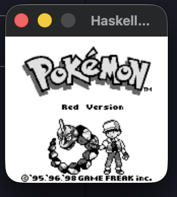
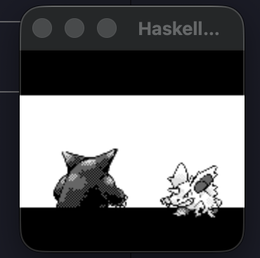

# HaskellBoy

A Game Boy / Game Boy Color emulator written in Haskell, with an optional Cranelift JIT backend written in Rust.

<p align="center">
  
  
</p>

## Features

- Full SM83 CPU emulation with cycle-accurate instruction timing
- PPU with per-scanline rendering, VRAM/OAM access blocking, and STAT interrupt handling
- APU with all four channels: pulse (sweep + envelope), wave, and noise
- MBC1/MBC3 cartridge support
- Game Boy Color mode (CGB palette, dual VRAM banks)
- Headless mode for automated testing (Blargg test ROMs)
- Cranelift-based JIT compiler with tiered dispatch

## Running

```bash
# Interpreter (default)
cabal run haskellboy -- path/to/rom.gb

# JIT mode
make all   # builds the Rust JIT library + Haskell project
cabal run haskellboy -- --jit path/to/rom.gb
```

### Controls

| Key | Button |
|-----|--------|
| Arrow keys | D-Pad |
| Z | A |
| X | B |
| Enter | Start |
| Backspace | Select |

## Building from Source

### Prerequisites

- [GHC 9.10.3](https://www.haskell.org/ghcup/) (via ghcup)
- [Rust toolchain](https://rustup.rs/) (for the JIT backend)
- SDL2 (`brew install sdl2` on macOS)

### Build

```bash
# Haskell only (interpreter mode)
cabal build

# Full build including Cranelift JIT
make all
```

### Tests

```bash
cabal test cpu-tests      # 500 SM83 opcode unit tests
cabal test rom-tests      # Blargg cpu_instrs.gb (11 sub-tests)
cabal run blargg-tests    # Full Blargg test suite (57 tests)
cd jit && cargo test      # Rust JIT unit tests (47 tests)
```

The emulator passes all 11 Blargg `cpu_instrs` tests, `instr_timing`, and all `mem_timing` / `mem_timing-2` tests.

## Architecture

### Effect System

The emulator is built on [`effectful`](https://hackage.haskell.org/package/effectful-core), using a polymorphic effect stack instead of a concrete monad. All CPU, GPU, and APU functions are written against effect constraints rather than a fixed type, which means the execution backend can be swapped at the handler level without touching emulation logic.

```haskell
-- No concrete monad — just effect constraints
step :: (MemoryBus :> es, EmulatorEnv :> es, Trace :> es) => Eff es Word16
```

The key effects:

| Effect | Purpose |
|--------|---------|
| **MemoryBus** | Memory reads/writes with per-M-cycle ticking |
| **CpuBackend** | Fetch-decode-execute orchestration |
| **EmulatorEnv** | Holds all mutable emulator state (STUArray/STRef) |
| **Display** | Frame output (SDL or headless) |
| **AudioOut** | Audio output (SDL or headless) |
| **Trace** | Instruction tracing (silent or stderr) |
| **Input** | Joypad input (SDL or headless) |

This design pays off concretely: the same emulation code runs under an interpreter handler for correctness, a tracing handler for debugging, a test handler with flat 64K memory and no GPU ticking, or the Cranelift JIT handler for performance — all selected at startup by swapping the `CpuBackend` and `MemoryBus` handlers.

### JIT Backend

The JIT backend uses [Cranelift](https://cranelift.dev/) 0.116 to compile hot Game Boy basic blocks into native machine code at runtime. It's implemented as a Rust static library (`jit/`) linked into the Haskell binary via FFI.

**How it works:**

1. A hot counter tracks visit counts per PC address
2. When a block crosses the compilation threshold (10 visits), it gets compiled to native code via Cranelift
3. Compiled blocks run until they hit an I/O instruction (memory-mapped read/write), at which point they exit back to Haskell
4. The Haskell interpreter replays the I/O instruction, ticks the GPU/APU, and returns control to the JIT

This "I/O exit" design keeps all the complex memory-mapped I/O handling in Haskell where it's easier to get right, while letting the JIT handle pure compute (ALU ops, register shuffling, control flow) at native speed.

### Module Map

```
src/
  Types.hs          -- Memory record, registers, instruction types
  Memory.hs         -- Memory constructors, register accessors
  MemoryRules.hs    -- MemoryBus handlers (full emulation vs flat test)
  CPU.hs            -- Instruction decode/execute, interrupt handling
  GPU.hs            -- Scanline renderer, LCD mode state machine, timer
  APU.hs            -- Audio: frame sequencer, channels, envelopes
  GBC.hs            -- Main loop, effect stack assembly
  Cartridge.hs      -- ROM loading, MBC banking
  Monad.hs          -- SDL wrappers
  Effects/           -- Effect type definitions (GADTs)
  Effects/Handlers/  -- Effect implementations (SDL, headless, JIT)
  JIT/               -- Cranelift FFI bindings, pointer extraction, scheduler
jit/
  src/               -- Rust Cranelift JIT engine
  tests/             -- Rust integration tests
```

## License

GPL-2.0 — see [LICENSE](LICENSE) for details.
